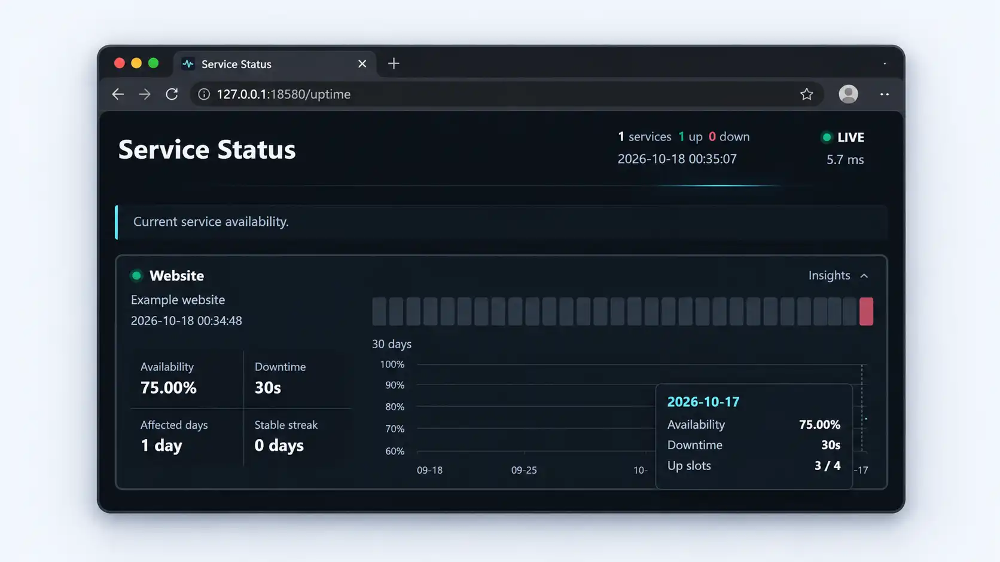

# LibreCosta Uptime

LibreCosta Uptime is a self-hosted HTTP/HTTPS monitor in a single binary, configured
with YAML and backed by bbolt by default, so no external database is needed.



## Quick Start

Download the archive for your system from [GitHub Releases](https://github.com/librecosta/uptime/releases/tag/v0.1.0):
Linux and macOS (`darwin`) support amd64 and arm64; Windows supports amd64.
Choose amd64 for Intel/AMD x64 or arm64 for Apple Silicon and ARM64 Linux.
Verify the download against the release's `SHA256SUMS`, then extract the `.tar.gz`
or Windows `.zip` into a new directory. No Go installation is needed.

From the extracted directory, copy the example and edit `uptime.yaml` to set the
endpoints you want to monitor before validating and starting the service.
The example needs no Redis, TLS, or authentication environment variables.

**Linux / macOS:**

```sh
cp uptime.example.yaml uptime.yaml
# Edit uptime.yaml before continuing.
./uptime config check --config ./uptime.yaml
./uptime serve --config ./uptime.yaml
```

**Windows PowerShell:**

```powershell
Copy-Item .\uptime.example.yaml .\uptime.yaml
# Edit uptime.yaml before continuing.
.\uptime.exe config check --config .\uptime.yaml
.\uptime.exe serve --config .\uptime.yaml
```

Open **http://127.0.0.1:18580/** to reach the dashboard. Press **Ctrl+C** to stop.
History is stored in `./data/uptime.db` and survives restarts. Keep that file when
upgrading. The default listener accepts connections only from the local machine.

### Other installation options

For Docker on Linux amd64/arm64, run `docker pull ghcr.io/librecosta/uptime:v0.1.0`,
then follow the
[Docker guide](https://github.com/librecosta/uptime/blob/v0.1.0/docs/deployment/docker.md)
to mount configuration and persistent storage.

With **Go 1.26+**, you can also install from the versioned module:

```sh
go install github.com/librecosta/uptime/cmd/uptime@v0.1.0
```

Put Go's binary directory first in `PATH` and save the
[example YAML](https://github.com/librecosta/uptime/blob/v0.1.0/configs/uptime.example.yaml)
as `uptime.yaml`. Use `uptime` in place of `./uptime` below. Go installs retain
`dev` / `unknown` version metadata; release archives include the version and commit.

## Features

- HTTP/HTTPS endpoint checks with GET or HEAD, custom headers, timeouts, and
  expected status codes.
- A status dashboard and JSON API, with current availability and daily history.
- Configurable retention, dashboard history window, and timezone.
- Local bbolt persistence or optional Redis storage.
- Native HTTPS and optional single-user Basic Auth for the dashboard and API.
- Health endpoints and CLI commands to list services, export history, and remove
  retired services explicitly.

## Configuration

Start with the commented [example configuration](https://github.com/librecosta/uptime/blob/v0.1.0/configs/uptime.example.yaml).
Run `config check` after editing it and restart `serve` to apply changes.
Validation does not open the database or start monitoring; enabled TLS certificate
and key files are checked before startup.

Relative database, TLS, and output paths use the **process working directory**,
not the YAML file's directory. Keep the same working directory between runs, or
use absolute paths.

`uptime.interval` is the default probe interval; endpoints can override it.
`uptime.retention` controls how long history is kept, while `uptime.window`
controls the dashboard's displayed range. `uptime.timezone` defines calendar-day
boundaries. The defaults are 10 seconds, 90 days, 30 days, and UTC respectively.

Endpoint IDs are persistent identities. Keep them stable: changing an ID starts
separate history, and removing an endpoint from YAML does not delete its history.

For all fields and validation rules, see the
[configuration reference](https://github.com/librecosta/uptime/blob/v0.1.0/contracts/compatibility.md#yaml-configuration-p2).

### Storage

| Backend | When to use it |
| --- | --- |
| `bbolt` (default) | A local database file with no external service. One process owns the file at a time. |
| `redis` | An existing Redis server, with a configured database and key prefix. Each monitor still runs its own probes. |

To use Redis, set `storage.type` to `redis` and provide `UPTIME_REDIS_URL` for the
example's `storage.redis.url`. Variables in inactive storage branches are ignored,
as are TLS/Auth variables while those features are disabled.
Switching backends does **not** migrate existing history.

### Native TLS and Basic Auth

Use HTTPS for remote access, either through native TLS or a trusted TLS reverse
proxy. A proxy on the same host can use the default loopback listener. Set
`server.address` to `:18580` when the listener must be reachable from outside the
host or through Docker port publishing, and restrict exposure appropriately.

For native TLS, enable `server.tls.enabled` and supply a matching certificate and
private key using the example's TLS variables. Connect using a hostname covered
by the certificate. For Basic Auth, enable `auth.enabled` and supply its username
and **bcrypt password hash**, never a plaintext password. For non-ASCII passwords,
hash the NFC-normalized password. Basic Auth does not encrypt credentials.

## Service Management

**Stop `serve` before using any service command with bbolt.** The database must
already exist. Redis supports online queries, but an export is not a transactional
snapshot across queries.

From the directory containing your binary and configuration, list services and
export an existing ID. These examples use Linux/macOS syntax; in PowerShell,
replace `./uptime` with `.\uptime.exe`.

```sh
./uptime service list --config ./uptime.yaml
./uptime service export website --config ./uptime.yaml --output ./website.json
```

The list shows persisted IDs, `active` or `detached` configuration status, and
last-seen times in UTC. Active means present in the current YAML, not necessarily
online. Export writes Archive v1 JSON containing retained daily history and the
current day's sample summary. Existing output files are never overwritten; the
parent directory must exist and support hard links. An export is not a database
backup, and there is no archive import.

To retire a service, first remove its ID from YAML and stop or update every monitor
still writing that ID. Then explicitly remove the stored service:

```sh
./uptime service remove website --config ./uptime.yaml
```

Removal permanently deletes its history, with no confirmation prompt or automatic
export. IDs still in the current YAML and unknown stored IDs are rejected. Shared
Redis writers must be coordinated; detached status does not prove they have stopped.
Maintenance commands accept explicit `endpoints: []` after the last endpoint is
retired; `serve` and `config check` still require at least one endpoint.

Use `./uptime --help` for command help and `./uptime version`
for build information.

## Health Checks

| Route | Purpose |
| --- | --- |
| `/livez` | Reports that the HTTP process is responding. |
| `/readyz` | Returns 200 when the server is ready and storage responds, otherwise 503. |

A monitored endpoint being down does not make the monitor unready. Health routes
remain unauthenticated when Basic Auth is enabled. The default dashboard is at
`/uptime`, with its JSON API at `/uptime/api/status`; both follow `ui.path`.

## Deployment and Development

- [Docker deployment](https://github.com/librecosta/uptime/blob/v0.1.0/docs/deployment/docker.md): use the GHCR Linux amd64/arm64
  image with mounted configuration and persistent data in a non-root container.
- [systemd deployment](https://github.com/librecosta/uptime/blob/v0.1.0/docs/deployment/systemd.md): run on Linux with a dedicated
  service account, persistent state, and graceful shutdown.
- [Build local distribution archives](https://github.com/librecosta/uptime/blob/v0.1.0/.agents/playbook.md#distribution-preview-p7-a)
  for Linux, macOS, and Windows, including checksums.
- [Development workflow](https://github.com/librecosta/uptime/blob/v0.1.0/.agents/playbook.md), [architecture](https://github.com/librecosta/uptime/blob/v0.1.0/.agents/architecture.md),
  [engineering contracts](https://github.com/librecosta/uptime/tree/v0.1.0/contracts), and [changelog](https://github.com/librecosta/uptime/blob/v0.1.0/CHANGELOG.md).

The deployment guides cover secure exposure, upgrades, and offline bbolt backups.

## Acknowledgments

[**Fiber Contrib Uptime**](https://github.com/gofiber/contrib/tree/main/v3/uptime)
is the monitoring engine behind LibreCosta Uptime, providing endpoint probes,
the dashboard, and the status API.

## License

[MIT](https://github.com/librecosta/uptime/blob/v0.1.0/LICENSE). Copyright (c) 2026 LibreCosta.
